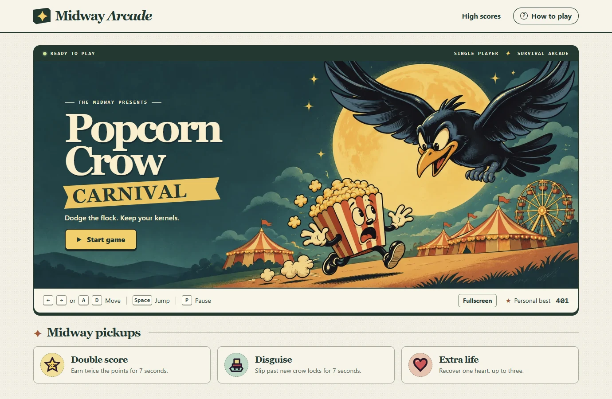
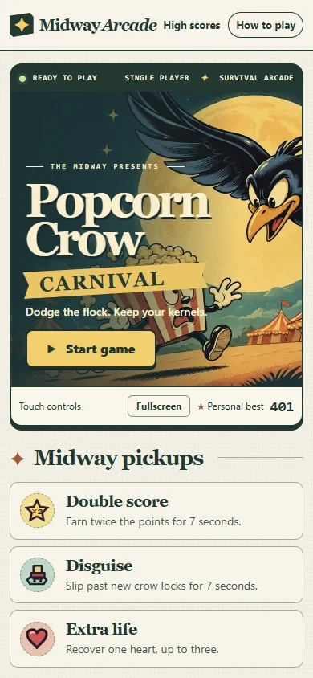

# Popcorn Crow Carnival

A single-player survival arcade for the browser and Windows desktop. Take control of a striped popcorn carton on the carnival midway. Read the flock, dodge each dive, and keep your three hearts for as long as you can.



## Play

| Action | Controls |
| --- | --- |
| Move | Left and right arrows, A and D, or the on-screen touch controls |
| Jump | Space, W, up arrow, or the touch Jump button |
| Toggle fullscreen | Fullscreen in the control strip |
| Pause or resume | P, Escape, or the pause and resume buttons |
| End a run early | Pause, then choose **Return to arcade** |
| Start another run | Choose **Play again** after the third hit |

Survival earns ten points per second. A warning mark means a crow is tracking you. Once the dive begins, its path is fixed. Jump as the crow descends to clear the bottom of its arc. The carton watches nearby crows, gasps when targeted, swings its shoes through each stride, and tucks them during a jump. Pick up a star for seven seconds of double scoring, a disguise for seven seconds of protection from new target locks, or a heart to recover one life. Finished runs compete for five local high-score slots.


[View the full gameplay screenshot](docs/screenshots/gameplay.webp)

<details>
<summary>Mobile title screen</summary>



</details>

## Run from source

Use Node.js 22 or later and pnpm. From the repository root, run:

```sh
pnpm install --frozen-lockfile
pnpm dev
```

Open the local URL printed by Vite. To type-check and create a production build:

```sh
pnpm build
pnpm preview
```

The generated `dist/` is a static site. Relative asset paths support serving it from a repository subdirectory, including GitHub Pages.

## Windows desktop

Install Rust and the platform build tools listed in the [Tauri prerequisites](https://v2.tauri.app/start/prerequisites/). Run the desktop app in development or build the portable executable and installers:

```sh
pnpm tauri dev
pnpm tauri build
```

The Windows build produces the standalone executable under `src-tauri/target/release/` and the NSIS and MSI installers under `src-tauri/target/release/bundle/`. The desktop app uses the system WebView2 runtime. Packaged binaries belong in the assets of a GitHub Release. The source tree contains the game, artwork, and screenshots.

## Implementation

- **TypeScript and Canvas 2D** handle movement, collisions, difficulty, and drawing. The simulation runs only during play and pauses when the window loses focus.
- **HTML and CSS** provide the title screen, controls, score table, and dialogs. The stage fits the viewing window. Narrow displays track the carton horizontally and show edge warnings for approaching dives.
- **WebP artwork and SVG sprites** keep the entire production web build around 332 KB before transport compression, down from 4.18 MB in the original build.
- **Tauri and Rust** provide the desktop host and local save commands. Browser scores use the original `popcorn-crow-save` key. Desktop scores use `save.json` in the application data directory for `com.popcorncrow.carnival`.

Game rules and tuning live in `src/game/`, with speed, spawn intervals, and power-up durations in `types.ts`. The title illustration is AI-generated. All runtime artwork ships with the application.
